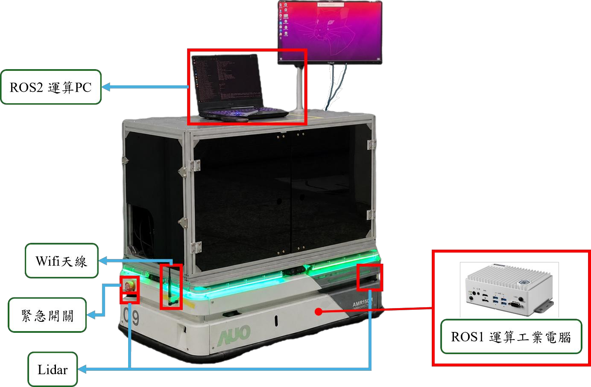
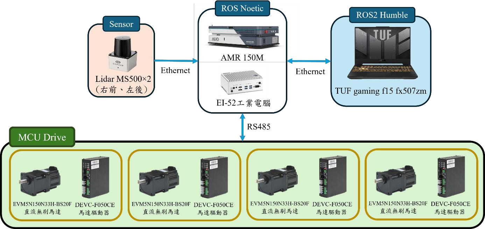

# Mecanum DRL Navigation

**基於深度強化學習之麥克納姆輪移動機器人的動態導航**
*Deep Reinforcement Learning-Based Dynamic Navigation for a Mecanum-Wheeled Mobile Robot*

本專案以 AMR150M 麥克納姆輪移動機器人為平台，使用 Soft Actor-Critic（SAC）學習局部避障策略，並整合 ROS 2 Nav2 的全域規劃流程。模型根據歷史 LiDAR 觀測與目標狀態，輸出前進、側向及旋轉速度，以處理室內靜態障礙與動態人物情境。

儲存庫提供機器人模型、Gazebo 模擬環境、強化學習訓練程式，以及 SAC、DWB、MPPI 三種局部控制器的導航設定。

## 專案結構

四個 ROS package 直接位於儲存庫根目錄。使用時，將整個儲存庫 clone 到 ROS 2 workspace 的 `src/` 下。

```text
mecanum-drl-navigation/
├── amr_nav2_drl/   # Nav2 外掛、SAC 推論、導航設定與實驗紀錄
├── amr_rl/         # Gymnasium 環境、訓練／評估程式與特徵擷取器
├── auo_model/      # AMR150M URDF/Xacro、mesh 與感測器模型
├── gazebo_sim/     # 場景、地圖與底盤控制
├── image/          # 系統與硬體架構圖片
└── README.md
```

## 硬體架構

系統採用雙主機分工：車載工業電腦負責感測資料與底盤控制，外接筆電執行定位、Nav2 規劃及 SAC 推論，透過 `ros1_bridge` 交換 ROS 1 / ROS 2 訊息。

<p align="center">
  
</p>


| 硬體 | 功能與配置 |
| --- | --- |
| AMR150M 底盤 | 四輪麥克納姆輪驅動，可前後移動、側向平移及原地旋轉 |
| 車載工業電腦 | Advantech EI-52，Ubuntu 20.04 / ROS Noetic，整合 LiDAR、里程計與 TF，並與底盤驅動模組通訊 |
| 導航運算主機 | ASUS TUF Gaming F15 FX507ZM，Ubuntu 22.04 / ROS 2 Humble，執行雷射融合、定位、導航與 SAC 推論 |
| 雙 LiDAR | 兩組 Orbbec MS500，配置於車體右前與左後，分別發布 `/urg_front/scan` 與 `/urg_back/scan` |

LiDAR 與車載電腦透過 Ethernet 連線，車載電腦經 RS485 與底盤驅動模組通訊；導航筆電透過區域網路接收感測資料並回傳速度命令。

<p align="center">
  
</p>

## 系統架構

前後 LiDAR 掃描經融合後發布為 `/scan`。NavFn 產生全域路徑，自訂的 `amr_nav2_drl::DrlController` 選取局部目標，SAC 推論節點再產生速度指令，由 Nav2 控制流程送至底盤。


Stage 3 的預設推論設定為 240 個雷射取樣點、4 幀歷史觀測、歷史間隔 3，以及 20 Hz 控制頻率。速度範圍為 `vx ∈ [-0.30, 0.47] m/s`、`|vy| ≤ 0.35 m/s`、`|wz| ≤ 0.80 rad/s`，詳見[推論參數](amr_nav2_drl/config/drl_inference_stage3.yaml)。模型的觀測、特徵擷取器及動作設定須與訓練時一致。

## 執行環境

導航主機使用 **Ubuntu 22.04 / ROS 2 Humble**。模擬程式使用 Gazebo Classic 的 `gazebo_ros` 介面，以下指令供該 Linux 環境使用。

| 類別 | 相依項目 |
| --- | --- |
| ROS 2 | Nav2、RViz2、TF2、Xacro、robot_state_publisher |
| 模擬與控制 | gazebo_ros、gazebo_plugins、gazebo_ros2_control、ros2_control、ros2_controllers |
| 感測器 | realsense2_description、提供 laserscan_multi_merger 的 ROS 2 版 ira_laser_tools |
| Python | NumPy、Gymnasium、PyTorch、Stable-Baselines3、TensorBoard、Matplotlib |

目前未提供鎖定版本的 Python 相依清單。使用既有模型時，請沿用其訓練環境版本，避免模型載入或觀測格式不相容。

## 啟動前設定

### 選擇單一里程計來源

目前 [mecanum_controller.py](gazebo_sim/src/mecanum_controller.py) 會發布輪速里程計及 TF，而 [base_amr150m.gazebo.xacro](auo_model/urdf/base/base_amr150m.gazebo.xacro) 也啟用了 Gazebo P3D 里程計外掛。使用前需選定來源，避免 `/odom` 或里程計 TF 重複發布。

訓練流程採 Gazebo 里程計：停用 `mecanum_controller.py` 中的里程計發布與對應 TF 發布，保留輪速控制，並確認 P3D 外掛啟用。若採輪速里程計，則停用 P3D 的重複輸出。更改後重新編譯並重啟模擬。

### 動態人物

[school_8f_square.world](gazebo_sim/worlds/school_8f_square.world) 的人物 actor 區塊目前有註解。動態場景需要啟用對應區塊，並備妥人物資源與 `libActorCollisionsPlugin.so`。場景中的外掛路徑是原開發電腦的絕對路徑，必須改成自己的實際位置；此外部外掛未包含在本庫。

## 強化學習訓練

`amr_rl` 提供 `train_stage0`、`train_stage1`、`train_stage2`、`train_stage3`、`train_stage3_1`，以及 `eval_stage0`、`eval_stage1`。不同階段對應不同環境與設定，跨階段載入前須確認觀測與動作格式相容。

以下以 Stage 3 為例。先完成里程計、動態人物與相依設定，再啟動模擬：

```bash
ros2 launch gazebo_sim amr150m_gazebo_square_stage3_1.launch.py
```

另一個終端執行訓練：

```bash
ros2 run amr_rl train_stage3_1
```

瀏覽器開啟 `http://localhost:6006/` 查看紀錄。完整參數可用 `ros2 run amr_rl train_stage3 --help` 查詢，包含模型載入、replay buffer、checkpoint 與環境設定。開始訓練前須確認 `/scan`、`/odom` 及 `/set_entity_state` 服務可用。

## Nav2 導航

以下模擬 launch 各自包含 Gazebo，請一次只啟動一種，並先停止獨立啟動的模擬與訓練程序。

### SAC 局部控制器

先準備與 Stage 3 推論設定相容的 SAC 模型，再指定其絕對路徑：

```bash
ros2 launch amr_nav2_drl amr_nav2_drl_sim_stage3.launch.py 
```

### DWB 與 MPPI 比較

這兩種控制器不需要 SAC 模型，但仍需備妥模擬、感測器及底盤相依套件。

```bash
# DWB
ros2 launch amr_nav2_drl amr_nav2_navfn_dwb_sim.launch.py

# MPPI（先停止上一組導航與模擬）
ros2 launch amr_nav2_drl amr_nav2_navfn_mppi_sim.launch.py
```

在 RViz 使用 **2D Pose Estimate** 設定初始姿態，再使用 **Nav2 Goal** 設定目標。控制器設定分別位於：

- [SAC / DRL](amr_nav2_drl/config/nav2_params_drl_stage3.yaml)
- [DWB](amr_nav2_drl/config/nav2_params_navfn_dwb.yaml)
- [MPPI](amr_nav2_drl/config/nav2_params_navfn_mppi.yaml)


## 已知限制


## 研究來源

曾翔宇，〈基於深度強化學習之麥克納姆輪移動機器人的動態導航〉，自動化科技研究所碩士學位論文，2026 年 7 月。指導教授：林志哲。

研究以 SAC 作為局部控制器，與 NavFn 全域規劃整合，並以 DWB、MPPI 進行動態人物避障與跨場景導航比較。操作說明另參考專案使用手冊，指令與檔名以目前儲存庫內容為準。


## 執行影片：實驗三（正向動態障礙物避障）

實驗三模擬行人從正面接近機器人的情境，觀察機器人在前往目標途中如何調整路徑並避開行人。展示重點為 SAC（DRL）控制器運用麥克納姆輪的側向移動能力進行避讓，以及與 DWB、MPPI 的避障反應差異。

[▶ 觀看實驗三執行影片](image/Video%20Project.mp4)
