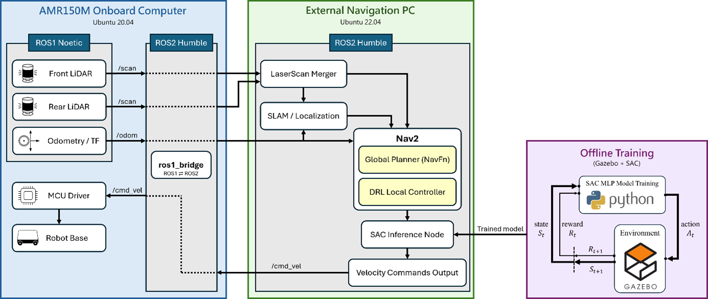

# Mecanum DRL Navigation

**基於深度強化學習之麥克納姆輪移動機器人的動態導航**
*Deep Reinforcement Learning-Based Dynamic Navigation for a Mecanum-Wheeled Mobile Robot*

本專案以 AMR150M 麥克納姆輪移動機器人為平台，使用 Soft Actor-Critic（SAC）學習局部避障策略，並整合 ROS 2 Nav2 的全域規劃流程。模型根據歷史 LiDAR 觀測與目標狀態，輸出前進、側向及旋轉速度，以處理室內靜態障礙與動態人物情境。

儲存庫提供機器人模型、Gazebo 模擬環境、強化學習訓練程式，以及 SAC、DWB、MPPI 三種局部控制器的導航設定。

## 專案結構

四個 ROS package 直接位於儲存庫根目錄。使用時，將整個儲存庫 clone 到 ROS 2 workspace 的 `src/` 下。

```text
mecanum-drl-navigation/
├── amr_nav2_drl/   # Nav2 外掛、SAC 推論、導航設定與實驗紀錄
├── amr_rl/         # Gymnasium 環境、訓練／評估程式與特徵擷取器
├── auo_model/      # AMR150M URDF/Xacro、mesh 與感測器模型
├── gazebo_sim/     # 場景、地圖、底盤控制與鍵盤遙控
└── README.md
```

## 系統架構

前後 LiDAR 掃描經融合後發布為 `/scan`。NavFn 產生全域路徑，自訂的 `amr_nav2_drl::DrlController` 選取局部目標，SAC 推論節點再產生速度指令，由 Nav2 控制流程送至底盤。



Stage 3 的預設推論設定為 240 個雷射取樣點、4 幀歷史觀測、歷史間隔 3，以及 20 Hz 控制頻率。速度範圍為 `vx ∈ [-0.30, 0.47] m/s`、`|vy| ≤ 0.35 m/s`、`|wz| ≤ 0.80 rad/s`，詳見[推論參數](amr_nav2_drl/config/drl_inference_stage3.yaml)。模型的觀測、特徵擷取器及動作設定須與訓練時一致。

## 執行環境與安裝

論文中的導航主機使用 **Ubuntu 22.04 / ROS 2 Humble**。模擬程式使用 Gazebo Classic 的 `gazebo_ros` 介面，以下指令供該 Linux 環境使用。

| 類別 | 相依項目 |
| --- | --- |
| ROS 2 | Nav2、RViz2、TF2、Xacro、robot_state_publisher |
| 模擬與控制 | gazebo_ros、gazebo_plugins、gazebo_ros2_control、ros2_control、ros2_controllers |
| 感測器 | realsense2_description、提供 laserscan_multi_merger 的 ROS 2 版 ira_laser_tools |
| Python | NumPy、Gymnasium、PyTorch、Stable-Baselines3、TensorBoard、Matplotlib |

目前未提供鎖定版本的 Python 相依清單。使用既有模型時，請沿用其訓練環境版本，避免模型載入或觀測格式不相容。

### 建立 workspace

先安裝 ROS 2 Humble 與 colcon、rosdep 等開發工具，再執行：

```bash
source /opt/ros/humble/setup.bash
mkdir -p ~/sac_ws/src
cd ~/sac_ws/src
git clone https://github.com/roberttseng812/mecanum-drl-navigation.git
cd ~/sac_ws
```

若儲存庫為私人，clone 時須使用具存取權限的 GitHub 帳號。

### 安裝相依與編譯

```bash
sudo apt update
sudo apt install ros-humble-navigation2 ros-humble-nav2-bringup \
  ros-humble-gazebo-ros-pkgs ros-humble-gazebo-ros2-control \
  ros-humble-ros2-control ros-humble-ros2-controllers \
  ros-humble-xacro ros-humble-realsense2-description \
  ros-humble-nav2-mppi-controller python3-pip

python3 -m pip install numpy gymnasium torch stable-baselines3 tensorboard matplotlib
rosdep update
rosdep install --from-paths src --ignore-src -r -y
```

若 rosdep 尚未初始化，先執行一次 `sudo rosdep init`。部分執行期相依未完整列入 manifest，仍須確認上表中的套件已備妥。`ira_laser_tools` 需要相容的 ROS 2 實作，並提供 `laserscan_multi_merger` executable。

`gazebo_sim/package.xml` 另宣告了本庫未附的 `hospital_robot_spawner`。若 rosdep 無法解析，請確認使用場景是否需要它並補齊，或在確認不使用後調整本機 manifest，再繼續安裝。

```bash
cd ~/sac_ws
colcon build --symlink-install
source install/setup.bash
```

每個新終端都要載入 `/opt/ros/humble/setup.bash` 與 `~/sac_ws/install/setup.bash`。

## 啟動前設定

### 選擇單一里程計來源

目前 [mecanum_controller.py](gazebo_sim/src/mecanum_controller.py) 會發布輪速里程計及 TF，而 [base_amr150m.gazebo.xacro](auo_model/urdf/base/base_amr150m.gazebo.xacro) 也啟用了 Gazebo P3D 里程計外掛。使用前需選定來源，避免 `/odom` 或里程計 TF 重複發布。

使用手冊的訓練流程採 Gazebo 里程計：停用 `mecanum_controller.py` 中的里程計發布與對應 TF 發布，保留輪速控制，並確認 P3D 外掛啟用。若採輪速里程計，則停用 P3D 的重複輸出。更改後重新編譯並重啟模擬。

### 動態人物

[school_8f_square.world](gazebo_sim/worlds/school_8f_square.world) 與 [school_8F.world](gazebo_sim/worlds/school_8F.world) 的人物 actor 區塊目前有註解。動態場景需要啟用對應區塊，並備妥人物資源與 `libActorCollisionsPlugin.so`。場景中的外掛路徑是原開發電腦的絕對路徑，必須改成自己的實際位置；此外部外掛未包含在本庫。

## Gazebo 模擬與鍵盤控制

```bash
ros2 launch gazebo_sim amr150m_gazebo_square_stage1.launch.py
```

另一個終端啟動鍵盤控制：

```bash
ros2 run gazebo_sim teleop_mecanum.py
```

此 launch 使用 `school_8f_square.world`。訓練與導航前請關閉鍵盤控制，避免多個節點同時送出底盤速度。

## 強化學習訓練

`amr_rl` 提供 `train_stage0`、`train_stage1`、`train_stage2`、`train_stage3`、`train_stage3_1`，以及 `eval_stage0`、`eval_stage1`。不同階段對應不同環境與設定，跨階段載入前須確認觀測與動作格式相容。

以下以 Stage 3 為例。先完成里程計、動態人物與相依設定，再啟動模擬：

```bash
ros2 launch gazebo_sim amr150m_gazebo_square_stage3.launch.py
```

另一個終端執行訓練，明確指定輸出目錄：

```bash
cd ~/sac_ws
ros2 run amr_rl train_stage3 \
  --total-steps 300000 \
  --logdir runs_stage3 \
  --modeldir models_stage3
```

續訓與訓練監測：

```bash
ros2 run amr_rl train_stage3 \
  --load-model /absolute/path/to/checkpoint.zip \
  --total-steps 300000 \
  --logdir runs_stage3 \
  --modeldir models_stage3

tensorboard --logdir ~/sac_ws/runs_stage3
```

瀏覽器開啟 `http://localhost:6006/` 查看紀錄。完整參數可用 `ros2 run amr_rl train_stage3 --help` 查詢，包含模型載入、replay buffer、checkpoint 與環境設定。開始訓練前須確認 `/scan`、`/odom` 及 `/set_entity_state` 服務可用。

## Nav2 導航

以下模擬 launch 各自包含 Gazebo，請一次只啟動一種，並先停止獨立啟動的模擬與訓練程序。

### SAC 局部控制器

先準備與 Stage 3 推論設定相容的 SAC 模型，再指定其絕對路徑：

```bash
ros2 launch amr_nav2_drl amr_nav2_drl_sim_stage3.launch.py \
  model:=/absolute/path/to/sac_stage3.zip
```

### DWB 與 MPPI 比較

這兩種控制器不需要 SAC 模型，但仍需備妥模擬、感測器及底盤相依套件。

```bash
# DWB
ros2 launch amr_nav2_drl amr_nav2_navfn_dwb_sim.launch.py

# MPPI（先停止上一組導航與模擬）
ros2 launch amr_nav2_drl amr_nav2_navfn_mppi_sim.launch.py
```

在 RViz 使用 **2D Pose Estimate** 設定初始姿態，再使用 **Nav2 Goal** 設定目標。控制器設定分別位於：

- [SAC / DRL](amr_nav2_drl/config/nav2_params_drl_stage3.yaml)
- [DWB](amr_nav2_drl/config/nav2_params_navfn_dwb.yaml)
- [MPPI](amr_nav2_drl/config/nav2_params_navfn_mppi.yaml)

## 實機與實驗紀錄

論文中的 AMR150M 車載端使用 ROS Noetic，導航主機使用 ROS 2 Humble，透過 `ros1_bridge` 交換感測資料與速度命令。本庫未提供完整車載驅動及 bridge 部署環境。

實機導航前，需先備妥底盤驅動、ROS bridge、雙 LiDAR、里程計、TF 與地圖，並完成兩台主機的時間同步。使用手冊採 Chrony 同步，網路位址須依實際設備設定。實機使用 `use_sim_time:=false`。

```bash
ros2 launch amr_nav2_drl amr_nav2_drl_stage3.launch.py \
  model:=/absolute/path/to/sac_stage3.zip \
  map:=/absolute/path/to/map.yaml \
  use_sim_time:=false
```

若已由其他節點發布融合後的 `/scan`，可加上 `use_laser_merger:=false`。實機 DWB 與 MPPI 對應 `amr_nav2_navfn_dwb.launch.py`、`amr_nav2_navfn_mppi.launch.py`。

導航系統就緒後，可用實驗節點指定目標並記錄資料。以下為模擬範例，目標座標須依地圖修改：

```bash
ros2 launch amr_nav2_drl nav2_experiment_runner.launch.py \
  use_sim_time:=true controller_name:=DRL \
  goal_x:=1.0 goal_y:=1.0 goal_yaw:=0.0 \
  output_dir:=$HOME/sac_ws/amr_nav2_experiments
```

`controller_name` 是輸出紀錄的標籤，不會切換正在執行的控制器。CSV 依 `<output_dir>/<controller_name>/<route_index>/` 分類儲存。

## 已知限制

- 本庫保留研究開發時的設定，執行前須處理外部相依、模型權重、場景外掛路徑與里程計來源。
- 模型、Python 套件及推論參數的版本與格式必須相容，目前未提供完整鎖版環境。
- 部分 package 描述、維護者及授權欄位仍是開發預設值，目前沒有儲存庫層級的 `LICENSE`。
- 本 README 依論文、使用手冊與原始碼核對，尚未在 ROS 2 / Gazebo 環境重新驗證完整執行流程。

## 研究來源

曾翔宇，〈基於深度強化學習之麥克納姆輪移動機器人的動態導航〉，自動化科技研究所碩士學位論文，2026 年 7 月。指導教授：林志哲。

研究以 SAC 作為局部控制器，與 NavFn 全域規劃整合，並以 DWB、MPPI 進行動態人物避障與跨場景導航比較。操作說明另參考專案使用手冊，指令與檔名以目前儲存庫內容為準。
